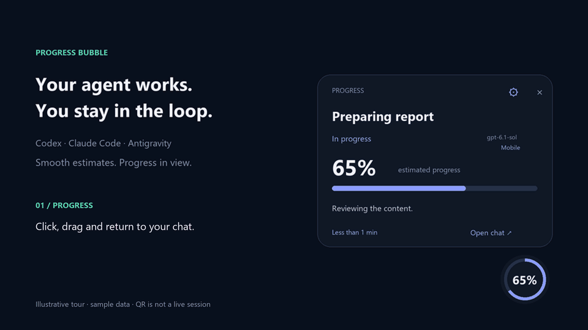

<div align="center">


# 🫧 Progress Bubble

### Your agent works. You stay in the loop.

Automatic progress tracking for your AI agent, with a floating desktop bubble, visible progress and estimated time remaining.

**Codex · Claude Code · Google Antigravity**

[](https://github.com/EvandroSilvaPinto/progress-bubble/actions/workflows/tests.yml)
[](https://www.python.org/downloads/)
[](LICENSE)

[Feature tour](#feature-tour) · [Get started](#get-started) · [How it works](#how-it-works) · [Supported agents](#supported-agents)

</div>



<p align="center"><sub>Illustrative tour with sample data. Quota is optional and off by default. The example QR does not open a live task.</sub></p>

<a id="feature-tour"></a>
## 🎬 Explore every feature

The animation walks through seven views in order: **progress → settings → colors → optional subscription usage → QR sharing → phone viewer → parallel tasks**. Prefer a still image? [Open the complete visual overview](assets/feature-tour.png).

| Feature | Try it | What you will see |
| --- | --- | --- |
| Automatic tracking | Ask the installed skill for a task expected to exceed 30 seconds | A task-specific HTML page and, on native Windows, a floating bubble. Short tasks do not need a new tracker. |
| Floating bubble | Click to expand; drag to reposition | Task percentage and a smooth progress ring above other windows. |
| Progress card | Open the bubble while work continues | Title, status, message, percentage and a progress bar. Remaining time is a duration, never an exact finish time. |
| Smooth estimated progress | Provide a remaining-time estimate | The ring and bar advance conservatively between agent updates, capped at 95%; only confirmed completion reaches 100%. |
| Return to the conversation | Select **Open chat** when an origin is available | The original conversation opens. HTML details remain available as a fallback. |
| Model identification | Inspect the label above **Mobile**; hover a shortened name | The current chat's verified model name, or **Model unavailable**. Model identification stays local. |
| One settings menu | Click **⚙**, right-click, or press **Ctrl+,** | Colors, card size, bubble size and subscription-usage visibility together. Settings also work in the QR view. |
| Five editable colors | Choose **Colors**, hover a circle, then click it | A centered palette with tooltips and native color selection. Changes save immediately without contrast warnings. |
| Reset colors | Keep the palette visible and reopen Settings | **Reset colors** restores all default shades while preserving sizes. |
| Independent sizes | Open **Sizes** and choose Small, Medium or Large | Card plus palette scale together; the bubble has its own size choice. Windows display scaling is respected. |
| Optional subscription usage | Enable **Show subscription usage** in Settings | A separate quota bar in the card and a thin outer bubble ring. It is **off by default**; hidden trackers stop scheduling quota reads. |
| Usage windows and colors | Click the subscription window label when alternatives exist | Switch between short and weekly windows. Quota changes from green to yellow, orange and red as it fills. |
| Renewal countdown | Reach 100% with a real provider reset timestamp | Only the card shows time until renewal. The bubble keeps the quota ring without quota numbers or renewal text. Missing or stale readings are identified. |
| In-card QR | Click **Mobile** | A temporary read-only link is generated without a confirmation dialog. Its QR replaces the card contents without enlarging the card or opening a browser. **Back** restores progress; **Copy link** copies the reader URL. |
| Another device | Scan a real task's QR using your phone | A responsive web viewer with task progress and remaining time. No viewer account or inbound connection to the computer is required. |
| Private temporary sharing | Share one chosen task, then revoke it or let it expire | Separate reader/writer keys; expiry within 24 hours or one hour after completion. Model names, quota and conversation URLs are not uploaded. |
| Parallel tasks | Start another independent tracker | Separate bubbles open with an offset so simultaneous tasks remain discoverable. Each has its own status and sharing link. |
| Two close controls | Click the card's **×**, then hover the bubble | The card's × collapses just the card. The separate × above the bubble closes its window. Work can continue updating the files. |
| Completion cleanup | Start the next interaction in the same chat | Completed bubbles associated with that chat close automatically; active tasks and other chats remain untouched. |
| Smooth transitions | Open, collapse or switch to the QR view | Short transitions keep the bubble stationary and QR sharp; Windows reduced-motion preferences are respected. |
| Portuguese and English | Launch with either system display language | Controls, tooltips, states and remaining time follow the detected language; task content stays as written. Other languages fall back to English. |
| Saved preferences | Change a color, size or usage setting; open another tracker | Preferences persist across tasks, and open trackers receive changes on refresh. Existing choices survive updates. |
| HTML and cloud mode | Run without a native Windows desktop | An HTML progress page works without a floating window. Explicit web sharing lets a cloud agent publish updates for the phone. |
| Three agent integrations | Install for Codex, Claude Code or Antigravity | Shared tracking scripts and agent-specific setup. Quota integration support differs by provider; see the subscription section below. |
| Easy updates | Run the documented installer update command | Refresh the installed skill with a backup of the previous version. Restart existing tracker windows to load new code. |

**Demo boundaries:** these images explain the interface; they are not a screen recording or a live session. The optional quota scene uses sample values. Codex supports automatic quota reads with a signed-in local client, Claude Code needs its bridge, and Antigravity needs a trusted feed adapter. See the sections below for setup, privacy and platform limitations.

To regenerate the tour assets locally (Pillow is needed only to render documentation):

```powershell
python tools/render_feature_tour.py
```

## ✨ Fewer window switches. More clarity.

Asked your agent to work on something while you focus elsewhere? **Progress Bubble** keeps progress visible above your other windows. Click the bubble whenever you want more context. Card backgrounds reuse symmetric corners and uniform pixel spans for faster first opening, preserving native-resolution antialiasing. Its circular background is filled through the outer contour, including the space between progress and optional quota rings, so light windows do not show through the bubble.

| At a glance | On click |
| --- | --- |
| 🫧 Percentage and progress ring | 📋 Status, message and time remaining |
| 🎨 Completion, failure and waiting colors | 📊 Estimated progress bar |
| 🖱️ Drag it wherever you prefer | 🔗 Return to the chat or open HTML details |

**Local by default.** Runtime scripts send no telemetry and need no server, extra account or pip dependencies.

> **Before installing:** the floating bubble requires **native Windows + Python 3.10 or later with Tkinter**. On macOS, Linux, WSL and environments without a desktop, use the HTML progress page.

## 🧠 Model identification

The desktop card identifies the model used by its own chat, above **Mobile**. Codex reads only the current thread's local model metadata, respecting `CODEX_HOME`; it does not infer the model from shared quota or another chat. A long name is shortened to fit, with the full name available on hover. When metadata is unavailable, the card says **Model unavailable**.

For clients that expose a confirmed model name to the agent, pass `--model-name "known-model-id"`; use `--model-name none` to clear it. Claude/Antigravity integrations must supply a real model name instead of guessing from account limits. Model names remain local and are excluded from mobile sharing. A model label identifies the chat; the subscription bar can still represent quota shared by multiple models.

## 📊 Subscription usage in the desktop tracker

The Windows card can show a second bar for **real subscription quota**, independently of task progress. Click **Subscription · 5h** to switch to the weekly window when available. The same selected window appears as a thin outer bubble ring: green below 60%, yellow from 60%, orange from 80%, and red from 95%. Long card messages collapse to one measured, ellipsized line when the quota bar is visible; their full content remains in the local files. The bubble keeps only its task percentage; it shows no quota percentage or renewal text.

At 100% quota, **only the card** displays the remaining duration until renewal (for example, “Renews in 2h 15min”), using the provider's reset timestamp. Without a reset timestamp it says reset unavailable. After the timestamp passes, it waits for a fresh provider reading rather than inventing a zero. Stale/missing data displays unavailable or outdated; quota never advances from the task's time estimate.

- **Codex:** automatically detected from a confirmed Codex conversation origin. Uses the installed official `codex app-server` account-rate-limits method, without model turns or opening authentication files. Reads are cached across bubbles and throttled to once per minute; Tk remains responsive. An existing signed-in Codex CLI/client is required.
- **Claude Code:** the included bridge accepts the documented statusLine JSON for supported subscriptions. Enable it once with `python skills/progress-bubble/scripts/usage_bridge.py --setup-claude`, then use `--usage-provider claude` in tracker commands. Restart Claude Code afterward. The bridge is a silent quota receiver; renewal text is rendered only in the desktop card. Existing custom statuslines are preserved: setup refuses to replace one, so integrate `accept_feed('claude', payload)` into that script instead. A missing quota window remains unavailable. Data arrives when Claude emits statusline updates, rather than through an unsupported credential-based endpoint.
- **Antigravity:** `--usage-provider antigravity` supports a local normalized feed, but an automatic IDE/CLI quota adapter has not been validated. It displays unavailable until a trusted adapter supplies real values. No estimated quota or fabricated integration is provided.

Override detection with `--usage-provider codex`, `claude`, `antigravity`, or `off`. Provider selection is preserved for updates to the same tracker. Quota caches live under the user's `ProgressBubble/usage` configuration folder, separately namespaced by the Codex/Claude configuration profile. `CODEX_HOME` and `CLAUDE_CONFIG_DIR` are respected; Antigravity receivers can use `PROGRESS_BUBBLE_USAGE_PROFILE` to distinguish profiles. A successful provider response with no windows clears the old quota; transport failures retain a bounded last-known snapshot. Only normalized numeric quota windows and observation times are retained; credentials and account identifiers are excluded.

**Local only:** subscription quota is not uploaded to the mobile service and is not shown to temporary-link viewers. The local JSON can contain the normalized snapshot; treat tracker files as private. The browser/mobile viewer still shows task progress only. No extra hosting or paid service is required.

The Antigravity feed contract is `{"windows":{"primary":{"used_percent":42,"window_minutes":300,"resets_at":1790000000}}}` on stdin to `usage_bridge.py --provider antigravity`; timestamps are Unix seconds and must come from the provider. A bridge is a receiver, not a quota estimator.

Provider references: [Codex account rate limits](https://learn.chatgpt.com/docs/app-server), [Claude statusLine rate limits](https://code.claude.com/docs/en/statusline#rate-limit-usage), [Antigravity usage command](https://antigravity.google/docs/cli/commands/usage/).

## 📱 Follow a task on your phone

Open **Mobile** in the desktop progress card to generate a temporary sharing link immediately, then scan the QR code shown **inside the same card**. The QR replaces the other card information without increasing the card size. Short 160 ms transitions soften opening, closing and switching between progress and QR; they keep the bubble stationary and the QR sharp. Windows reduced-motion preferences are respected. No browser opens on the computer. **Back** returns to progress, and **Copy link** copies the read-only URL. The desktop QR is generated locally with a bundled encoder; no extra pip package, Node runtime or QR service is required. The web viewer also generates its QR locally. The viewer adapts to your screen and detects Portuguese or English. Its footer omits the explanatory sentence about estimated progress.

**Local by default.** Sharing is opt-in for each task. The hosted viewer uses Cloudflare Workers Free and D1 Free; end users need no account. Anyone holding a private link can read that task until it expires, so treat the link and QR as private.

For a cloud agent or command-line task, explicitly opt in when creating the tracker:

```powershell
python skills/progress-bubble/scripts/status.py --output outputs/mobile.html --title "Preparing report" --percent 10 --message "Working" --eta-minutes 5 --web-url https://progress-bubble-mobile.dev-evandrosilvapinto.workers.dev
```

Subsequent updates to the same output automatically sync. The command prints a **read-only** link and adds a mobile link to the local HTML. Windows users can open the bubble with `--open`; cloud agents only need Python and outbound HTTPS. Your computer does not need to expose a port or remain reachable from the phone, but the executing agent must keep sending updates.

To revoke a particular task immediately:

```powershell
python skills/progress-bubble/scripts/status.py --output outputs/mobile.html --stop-sharing
```

If revocation cannot reach the service, it remains pending and retries on the next update. Keep the private settings until the retry succeeds; existing links remain valid until revocation reaches the server or their original expiry.

- Links expire after **24 hours maximum**, or **one hour after the first confirmed completion**, whichever comes first. Updates never extend this lifetime.
- Only title (120 characters), message (280 characters), status, percentage, language and estimate fields are uploaded. Conversation URLs, local paths and app commands are excluded. Keep sensitive information out of titles/messages.
- Separate random read/write keys prevent the viewer from updating tasks. Keep the publishing machine clock synchronized (new session IDs allow five minutes of clock skew). Writer keys remain in private user configuration under `ProgressBubble/sessions`, outside HTML/JSON deliverables. The API stores only key hashes.
- No global task list, analytics, external fonts or runtime CDNs. Responses disable caching; reader secrets use the URL fragment and are removed from the visible address after opening.
- Visible viewers poll every **15 seconds**; progress/time remaining animate locally. Polling pauses in hidden tabs and stops at expiry. Offline views clearly show that they have old data.
- Expiry/revocation blocks access immediately on the server. Hourly cleanup removes expired rows; Cloudflare D1 Free recovery backups can retain previous data for **seven days**, so expiry is not a promise of immediate physical erasure.

The shared free service is subject to availability and account-wide quotas. It limits creation to 5/minute/IP, API traffic to 120/minute/IP and active sessions to 500. Free-tier exhaustion stops access rather than enabling billing or bypassing authorization. See [deployment and self-hosting](docs/mobile-hosting.md) for isolation, quotas and deployment commands. Set `PROGRESS_BUBBLE_WEB_URL` to use your own service for the desktop button.

## 🌐 Automatic language detection

The interface detects the system language when it starts:

| System language | Interface language |
| --- | --- |
| Portuguese, including Brazil and Portugal | Portuguese |
| English | English |
| Other or unidentified languages | English |

Windows detection uses the **user's display language**, rather than regional date and number formats. On other systems, HTML generation follows `LC_ALL`, `LC_MESSAGES`, `LANGUAGE` or `LANG`, in that order, falling back to Python's locale.

Buttons, menus, size labels, statuses, tooltips, notices and time remaining are translated. HTML pages use matching language attributes, accessible labels and countdown text. Task titles and messages preserve the text supplied by the agent. The native color chooser follows Windows.

No translation downloads or configuration are required. After updating the skill or changing the system language, close old bubbles and open a new tracker. Technical status values in JSON and `--status`, and existing preference keys, remain compatible with earlier versions.

<a id="get-started"></a>

## 🚀 Get started in 3 commands

With Git and Python installed, open a terminal:

```powershell
git clone https://github.com/EvandroSilvaPinto/progress-bubble.git
cd progress-bubble
python install.py --agent all
```

The skill is copied into all three agents' personal skill folders. Reload skills or start a new agent session. Its instructions request automatic use in every interaction, without an explicit command.

**Only need one agent?** Choose its command:

```powershell
python install.py --agent codex
python install.py --agent claude
python install.py --agent antigravity
```

The installer protects existing installations: it stops and displays the path if a destination already exists. Use the update commands below to replace it with a backup.

<a id="supported-agents"></a>

## 🤝 One skill, three agents

| Agent | Explicit invocation | Personal/global installation |
| --- | --- | --- |
| **Codex** | `$progress-bubble` | `~/.agents/skills/` |
| **Claude Code** | `/progress-bubble` | `~/.claude/skills/` |
| **Google Antigravity** | `/progress-bubble` | `~/.gemini/config/skills/` |

The same `SKILL.md` and runtime scripts serve all three. Claude support targets **local Claude Code**, not Claude's web chat or skill synchronization to Cowork.

<details>
<summary><strong>Project installation, destination previews and skill-installer</strong></summary>

Install only in a specific project:

```powershell
python install.py --agent all --scope project --project-root "C:/path/to/project"
```

Codex and Antigravity share `.agents/skills/` in a project; Claude Code uses `.claude/skills/`.

Preview destinations without copying files:

```powershell
python install.py --agent all --dry-run
```

In Codex, you can also ask:

> Use $skill-installer to install https://github.com/EvandroSilvaPinto/progress-bubble/tree/main/skills/progress-bubble

For manual installation, copy the entire `skills/progress-bubble` folder into your agent's skill directory. `agents/openai.yaml` provides optional Codex metadata.

Existing Codex installations in `~/.codex/skills/` are updated in place. If both Codex locations contain a copy, resolve the duplicate before continuing. On macOS/Linux, use `python3` if needed. Older Antigravity versions may use legacy paths; in Antigravity CLI, `/skills reload` reloads skills.

</details>

## 🔄 Update with one command

From your cloned repository's folder, run:

```powershell
python update.py --agent all
```

To update one agent, replace `all` with `codex`, `claude` or `antigravity`:

```powershell
python update.py --agent codex
```

This fetches the latest version with `git pull --ff-only` and updates skills, installing missing ones as well. If Git cannot update the repository, installed skills remain unchanged. Resolve conflicting local changes before retrying. Fetching updates requires Git and internet access.

**Automatic backup:** the entire previous installation is saved in `progress-bubble-backups/`, next to the `skills/` directory. The terminal prints its location. Skill-file customizations remain in the backup and are not merged automatically. Colors in `ProgressBubble/colors.json` are preserved. If replacing an installation fails, that installation is restored; updates already completed in other destinations remain in place.

Reload skills or start a new agent session afterwards. Open bubbles retain their loaded version until closed and reopened.

<details>
<summary><strong>Update a project, preview changes or use a downloaded copy</strong></summary>

```powershell
python update.py --agent all --scope project --project-root "C:/path/to/project"
python update.py --agent all --dry-run
```

A dry run only displays destinations, without downloads or file changes. If you downloaded the latest ZIP instead of cloning, open the extracted folder and run:

```powershell
python install.py --agent all --update
```

This uses local files without fetching updates. To restore a backup manually, close bubbles, move the current installation to a separate backup folder and return the saved version to its original path. Then reload skills.

</details>

<a id="how-it-works"></a>

## 🔄 From request to delivery

**1. Install and ask for your work.** The skill instructs the agent to apply it in **every interaction**, without explicit invocation. A bubble and HTML page are created for tasks estimated to take more than **30 seconds**, or that exceed this time during execution. Quick requests only need the initial check.

**2. Keep going with your day.** Click the bubble to expand its card; drag to reposition it.

**3. Check the result.** Once delivery is complete and verified, the agent marks **100%**. The **card's ×** only collapses the card. To close the bubble, hover over it and click the **× above and outside its upper-right corner**. Completed trackers also close when a new interaction begins in the same chat; their HTML remains available. Closing a window does not cancel the task.

> **Estimated progress, without false precision.** The agent supplies actual progress updates; the interface can advance a separate visual estimate between them using the remaining-time estimate. The 30-second threshold is an instruction, not a system timer intercepting tasks. The description requests automatic use, and Codex permits implicit invocation. Actual selection depends on the agent discovering and following the skill. Installation does not create a background service or force the model to run it. If it does not appear, reload skills or start a new session.

To reinforce the preference in permanent instructions, add:

> Apply the progress-bubble skill at the start of every interaction, without explicit invocation. Close completed trackers from this chat and create progress tracking for tasks estimated to take more than 30 seconds or that exceed that time.

Use `AGENTS.md` for Codex, `CLAUDE.md` for Claude Code or Antigravity rules, according to your setup.

## 🎨 Make it yours

The gear replaces the old **Colors** link and groups **Colors**, **Sizes**, and **Show subscription usage**. Subscription usage is off by default; enable it here when desired. Existing saved choices are preserved. Unchecking usage hides both the card's quota bar and the bubble's outer quota ring; task progress stays visible. The preference is saved in `ProgressBubble/settings.json`, reused by future trackers and applied to open ones on refresh. Hidden trackers stop scheduling quota reads. Settings is also available with **Ctrl+,** and from the QR view. The card size stays unchanged.


Click the **⚙ Settings** icon, then **Colors**, to reveal five centered circles above the card. Hover for a tooltip and click to choose a color:

| Color | Controls |
| --- | --- |
| **Background** | Card and bubble backgrounds |
| **Text** | Titles, percentage and messages |
| **Progress** | Ring and bar |
| **Details** | Links and time remaining |
| **States** | Completion, failure and waiting |

Choices are applied and saved immediately, without contrast warning dialogs. **Reset colors** appears inside Settings only while the palette is visible. It restores every default shade, including derived and state colors. Other open trackers receive the changes on their next refresh. Statuses also use symbols and text. The green logo retains its original colors.

**Three sizes, two independent settings:** open **⚙ Settings → Sizes**, or right-click the bubble to open Settings. Choose **Small**, **Medium** or **Large** in each group:

- **Card and colors:** scales the card, its text and palette together.
- **Bubble:** scales the ring, percentage and its close button.

Medium uses the default scale; Small uses 85% and Large uses 120%, respecting Windows display scaling. Choices are stored in `sizes.json`, next to `colors.json`, and shared across trackers. Resetting colors preserves sizes. On Windows, menu callbacks remain available until the selected command runs. Close old bubbles and open a new tracker after updating.

**Sharper rendering:** color circles, card corners, the bar and close button use antialiased edges at their selected size and Windows scale. Text uses whole-pixel dimensions. Rendering uses the Python standard library with caching and no extra runtime dependencies.

**Dragging on Windows:** the floating window uses a frameless native configuration with non-client rendering disabled for that window, avoiding the Windows frame shadow during dragging. This does not change system-wide visual effects. Close old bubbles and open a new tracker after updating to load the window-style fix.

**Parallel tasks:** new trackers open offset to the left, with space between bubbles. When a row reaches the screen edge, the next starts above it. Free positions are reused. You can still drag each tracker; opening another does not move existing windows. Position allocation requires bubbles opened with this version; close and reopen older ones.

**Smooth estimated progress:** when the agent provides a remaining-time estimate, the bar, ring and percentage gradually advance between real updates. The visual estimate uses 90% of the remaining range toward 95% over the estimated duration, so it moves slightly slower than the estimate. For example, starting at 10% with 10 minutes remaining reaches about 86% after those 10 minutes, then stops at 95%. Actual agent updates can show a higher value, but automatic advancement never reaches 100%. Only confirmed completion reaches 100%.

The displayed value remains labeled as estimated progress; it is not a measurement of completed work. The saved JSON `percent` continues to record the agent's reported value. A revised estimate preserves visual continuity instead of jumping backwards. Waiting, failure or interruption freezes the visual estimate; resuming requires a new remaining-time estimate. Without an estimate, progress changes only when the agent reports an update. Reopening the HTML preserves the saved time anchor rather than restarting the animation.

**Discreet time remaining:** see “About 3 min left”, without an exact finish time. The agent supplies the estimate and can revise it as work progresses.

**Return to the chat:** **Open chat** opens the task's conversation when an origin link is available; otherwise, **Open details** opens the HTML. The floating window stays out of the taskbar and Alt+Tab.

## 🧪 Try it before using it with an agent

From the repository folder, open a demo:

```powershell
python skills/progress-bubble/scripts/status.py --output outputs/demo.html --title "Preparing report" --percent 35 --message "Organizing the content" --eta-minutes 3 --open
```

Update the same demo:

```powershell
python skills/progress-bubble/scripts/status.py --output outputs/demo.html --title "Preparing report" --percent 100 --status "Concluído" --message "Report delivered and verified"
```

`--status` uses Portuguese technical values even when the interface is English. Without `--open`, the command only generates HTML and JSON. Open the HTML in a browser to follow progress.

<details>
<summary><strong>Requirements, statuses and refresh frequency</strong></summary>

- **HTML/JSON:** Python 3.10+ and a browser.
- **Bubble:** native Windows, a graphical session, Tkinter and `pythonw.exe`. `python -m tkinter` opens a test window.
- **Agent:** skill support and permission to write files and execute Python. Installation does not change permissions or install Python.
- **Updates:** the agent aims to save real advances roughly every 30 seconds. The bubble reads saved data every 0.5 seconds; active HTML refreshes every second. The remaining-time counter updates in the interface; the displayed percentage can also advance smoothly from the time estimate, while the saved `percent` remains the value supplied by the agent.
- **Long calls:** blocking tools may prevent intermediate updates. Embedded HTML viewers may require manual refreshes.
- **Status arguments:** `Em andamento` (In progress), `Aguardando informação` (Waiting for information), `Concluído` (Completed), `Interrompido` (Stopped) and `Falha` (Failed). Only `Concluído` accepts 100%; on failure, preserve the percentage reached.
- **Customization:** adjust the threshold in `SKILL.md` and keep discovery metadata consistent. No last-update timestamp is shown.

</details>

<details>
<summary><strong>Privacy, remote execution and troubleshooting</strong></summary>

In local mode, data stays at your chosen file location. Optional mobile sharing uploads only the fields described above. Details open in the default browser; chat links open their original app or website. Avoid credentials or sensitive information in titles and messages. Do not publish real tracking files.

Use a different file for each task. Reopening the same JSON does not duplicate its window. The skill does not start with Windows or continue working after the agent stops. Long text is shortened in the card and preserved in HTML.

In WSL, containers and remote agents, use HTML. A remote script does not open a window on your local desktop. Your environment's permissions and policies still apply.

If the bubble does not appear, check requirements and run it in a terminal to see errors:

```powershell
python skills/progress-bubble/scripts/bubble.py outputs/demo.json
```

Scripts are resolved relative to the installed skill folder, without fixed personal paths. In Claude Code, `${CLAUDE_SKILL_DIR}` can identify that folder. Use `python`, `python3` or `py -3`, depending on the interpreter.

</details>

## 🛠️ Built to share and improve

The mobile feature is available in `main` and includes an independent security review and regression checks for session replay after cleanup, completion/cancellation races, delayed local writes, lost responses, malformed transports and switching private links in one tab. The API and viewer are deployed together; desktop-only usage remains local. The hosted deployment was verified on Workers Free ($0), including live isolated-session and revocation checks. Local validation passes 79 Python tests and 21 Node tests. Physical phone-camera scanning remains a device acceptance check.


Every project change must include a README update in the same delivery, as recorded in `AGENTS.md`. The optional GIF generator, `tools/render_demo.py`, uses Pillow only to create the image; the skill itself has no pip dependencies.

Tests cover installation for all three agents, relocated installations, existing-file protection, backups and updates, special characters, statuses, completion, colors, sizes, language detection, rendering and parallel placement. CI runs Python checks on **Windows and Linux**, with **Python 3.10 and 3.13**, plus the API/viewer/QR tests on **Node 24** with Python for independent desktop QR decoding.

```powershell
python -m unittest discover -s tests -v
```

**Validation scope:** installer, scripts and documented paths. The window has been inspected manually on Windows with Python 3.13. Automatic skill selection still needs checking in a session of each agent.

Found a problem or have an idea? [Open an issue](https://github.com/EvandroSilvaPinto/progress-bubble/issues). Pull requests are welcome. Include your operating system, Python version, command and expected result, without private data.

If this project helps you, a **⭐ on the repository** helps others find it.

---

**[MIT License](LICENSE)** · Bundled QR encoders retain their [Python BSD](skills/progress-bubble/scripts/qrcode/LICENSE) and [JavaScript MIT](web/public/vendor/LICENSE-qrcode.txt) licenses.

Independent project, not officially affiliated with OpenAI, Anthropic or Google.

Installation references: [Codex](https://learn.chatgpt.com/docs/build-skills) · [Claude Code](https://code.claude.com/docs/en/skills) · [Antigravity](https://antigravity.google/docs/skills). Paths checked on November 13, 2026.
